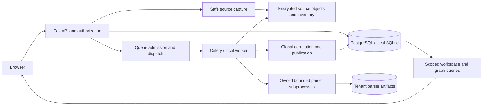

# ProjectTrace continuation: Wave 0 and initial P0 hardening

Date: 14 October 2026 (Asia/Kolkata). Verdict: **BLOCKED for pilot release**.

This is an engineering milestone, not completion of the master requirements. The existing platform is preserved. Developer Onboarding & Knowledge Transfer is not implemented. Durable global stage processing, production isolation and real-world acceptance remain release blockers.

## Preservation and source identity

Authoritative directory: `C:\Users\Varshith\OneDrive\Desktop\ProjectTrace-main`.
Initial source inventory: 452 files, 4,971,873 bytes; frontend version 1.6.0; migrations 0001–0020. There is no `.git` directory, so branch, commit and prior uncommitted status cannot be established. No ZIP was supplied alongside this directory; its original archive digest cannot be verified from extracted contents.

Before modification, every initial file was copied into `work/baseline/source-before.zip`, with per-file SHA-256 hashes in `work/baseline/manifest.json` in the Codex workspace. Backup ZIP SHA-256: `12c056cc95eb07b5d818d3460c584be1d1af082a02f0bd3bc0c87fd786fb85e2` (a newly created backup, not the original uploaded ZIP). No database, `.env`, source objects or encryption keys were present in the initial folder. Test databases and browser data are newly created disposable state. No migration or existing domain record was changed. No commit or push was made.

## Architecture inventory

| Boundary | Existing implementation | Responsibility |
|---|---|---|
| Browser | React 19, TypeScript, WorkspaceApp, administration, quality, graph, trust, SCM and engineering changes | Authorized engineering investigations and administration |
| API | FastAPI, backend/main.py and domain routers | Session/CSRF/rate controls, admission, authorization, queries |
| Authorization | security.py, governance.py, admin models and commands | Organization memberships, teams, repository grants/denials and feature policies |
| Source capture | repository_store.py, encrypted_archive.py, integrations/github/connector.py | Inert source admission, bounded inventory and encrypted source objects |
| Analysis | partitioned_analysis.py, analyzers/engine.py and owned parser helpers | Cached native file analysis followed by global aggregation |
| Jobs | queue.py, scheduling.py, jobs.py, local_jobs.py, workers | Retained encrypted input, leases, dispatch, recovery, atomic output transaction |
| Persistence | SQLAlchemy, Alembic, relational records, SnapshotView and finding history | Tenant-scoped evidence, claims, graph edges, snapshots and projections |
| Providers | GitHub/GHES, public GitHub, OIDC, OSV, read-only AWS | External identity and source/evidence inputs |
| Operations | compose.yaml, infrastructure, backup and benchmark scripts | PostgreSQL, Redis, API, Celery worker/beat, frontend |

Static AST inventory identifies 51 table declarations and 138 HTTP route declarations. `source-inventory.json` contains names and source locations. These are declarations, not proof of live routes; router prefixes are not expanded in that static inventory.

Untrusted repository bytes remain data. OS resource ceilings are implemented; filesystem/network sandboxing is explicitly not supplied by `process_limits.py`. Frontend visibility never substitutes for backend authorization. Platform operator access does not imply tenant source access.

## Initial capability classification

| Capability | Status | Current evidence / remaining qualification |
|---|---|---|
| Local import, native findings, claims and graph | PARTIAL | Existing regression and browser workflows; independent accuracy and complete large-source qualification outstanding |
| Bounded parsing and tenant parser cache | PARTIAL | Checkpoint regression; global observations still retained and recomputed |
| Durable independent global stages | MISSING | `analyze_inventory` still calls global `analyze` within the same execution |
| Atomic snapshot output | PARTIAL | Existing single output transaction; no private bounded publication generation |
| Lease fencing and cancellation | PARTIAL | Two additional fail-open paths reproduced and fixed; PostgreSQL concurrency still needs execution |
| ZIP admission and encrypted inventory | PARTIAL | Implemented bounded capture; durable asynchronous restartable admission remains outstanding |
| Administration and access governance | PARTIAL | Existing extensive local implementation; live identity and database qualification outstanding |
| OIDC/GHES/AWS/object storage | IMPLEMENTED_UNVERIFIED | Mocked tests cannot establish live provider integration |
| Developer onboarding, new hire and internal transfer | MISSING | No onboarding domain/API/UI found |
| Go/C#/Kotlin/Rust/C++ semantic expansion | ROADMAP | No claim of support made |
| Sustained load and disaster recovery | IMPLEMENTED_UNVERIFIED | Existing scripts and reports are not new qualification evidence |

## Changes and root causes

Requirement P0-LEASE-001: publication checkpoints must fail if lease ownership changes between the read and renewal. Previously the renewal ignored its affected-row count; cancellation/state predicates were also absent. The renewal now predicates job, tenant, repository, token, RUNNING state and absence of cancellation, then requires exactly one affected row. A successful update locks that queue row until transaction completion.

Requirement P0-LEASE-002: a token-bearing worker must not fall back to unfenced synchronous behavior when its scoped queue entry is unavailable. Previously a missing scoped row returned successfully. The checkpoint now raises JobCancelled for a claimed worker with no scoped queue row. Tokenless legacy synchronous work remains compatible.

Changed: `backend/scheduling.py`. Added: `tests/test_lease_renewal_race.py`. The new deterministic interleaving regression covers token replacement, cancellation flag and terminal state after the read, plus disappearance of a claimed queue entry. The first three cases failed before the first fix and passed after it. The fourth case separately failed before the second fix. These simulated interleavings are not a real PostgreSQL concurrent-session qualification.

No schema, migration, frontend source, dependency manifest or existing test assertion was changed. Rolling back this patch restores the two fail-open paths and is not recommended; the original source backup is retained for recovery.

## Technical debt and next implementation boundary

1. P0: Global findings/signals/assets/metrics and graph construction remain in-memory aggregate collections. Parser cache survival alone does not satisfy durable end-to-end execution.
2. P0: Publication still requires one output transaction; private staging generations and an authoritative published pointer are needed before bounded batch commits can be safe.
3. P0: Parser CPU/memory limits are not source-confidentiality filesystem/network isolation. Qualification needs the target deployment environment.
4. P0: ORM tenant validation explicitly does not protect direct SQL. Composite constraints/RLS and scoped worker identity must be reviewed in real PostgreSQL.
5. P0: Production PostgreSQL/Redis and live OIDC/GHES/cloud/storage scenarios are not configured in this environment. Do not convert skipped tests to passes.
6. P1: Large modules include main.py (1,963 lines), domain.py (1,636) and engine.py (1,580); decomposition must preserve domain transactions and authorization contracts.
7. P1: Both onboarding modes need a new integrated domain after P0 reliability and security gates. No placeholder feature pages were added.

## Validation and operational limits

Python 3.12.14 on Windows; dependencies installed from requirements.lock in the Codex workspace virtual environment. `pip check` passed. Frontend dependencies were ultimately installed using `npm ci --ignore-scripts --no-audit --no-fund` from package-lock.json. An initial pnpm range-resolution run was superseded by locked installation and reruns. Manifests remain unchanged; generated alternate lockfile was removed.

Exact command forms and final counts are recorded in the validation appendix. Logs/XML are adjacent output artifacts. Resource figures are test durations, not product benchmarks. There are no newly measured cold OpenMetadata/PetClinic/Outline workloads, independent accuracy percentages, production RLS results, provider credentials or disaster-recovery measurements.

Release remains BLOCKED. The next P0 increment must introduce private generation and immutable manifest persistence, stage leases/receipts and scoped reads together; adding stage labels to the current worker would not satisfy durability. See the accompanying durable-workflow design.

## Validation appendix

All runs occurred on 14 October 2026, Asia/Kolkata. Run backend commands from the ProjectTrace directory with the isolated virtual-environment Python executable. Set DATABASE_URL to a disposable workspace SQLite path and ANALYSIS_KEY_FILE to a disposable workspace key path; APP_ENV=demo. Browser qualification used a separate newly migrated and seeded `work/browser.db`, source directories under work/, JOB_MODE=local, and loopback-only API/UI services on ports 8011, 5181 and 5182.

| Check | Exact command arguments | Result |
|---|---|---|
| Original full backend baseline | `python -m pytest -q --tb=short --junitxml=<outputs>/baseline-tests.xml` | 518 passed, 9 skipped, 1 warning; 518.55 s |
| Final focused lease/publication regression | `python -m pytest tests/test_fair_scheduling.py tests/test_lease_renewal_race.py tests/test_timeout_recovery.py tests/test_worker_failure.py tests/test_postgresql_integration.py -q --tb=short --junitxml=<outputs>/reliability-regression.xml` | 17 passed, 8 skipped, 1 warning; 7.40 s |
| Worker integration regression | `python -m pytest tests/test_queue.py tests/test_local_jobs.py tests/test_administration_workers.py tests/test_real_pipeline.py -q --tb=short --junitxml=<outputs>/worker-regression.xml` | 14 passed, 1 warning; 34.94 s |
| Changed-file lint | `python -m ruff check backend/scheduling.py tests/test_lease_renewal_race.py` | Passed |
| Dependency consistency | `python -m pip check` | Passed |
| Locked frontend unit suite | `node node_modules/vitest/vitest.mjs run` | 41 passed across 10 files; 16.18 s |
| Locked frontend build | `node node_modules/typescript/bin/tsc -b` then `node scripts/build.mjs` | Passed; 42 public routes prerendered |
| Browser workflow baseline | `node node_modules/@playwright/test/cli.js test e2e/workflow.spec.ts e2e/administration.spec.ts e2e/repository-reliability.spec.ts e2e/public-site.spec.ts --output=<outputs>/browser-results` | 8 passed, 7 skipped; 1.2 min |

The initial full backend run began before source mutation; scheduling was already imported by its collection. The post-change focused and worker runs verify the changed runtime. These are overlapping suites and must not be summed as unique product checks.

Backend skipped tests require an explicitly configured disposable PostgreSQL database or are inspected opt-in cases. Inspect XML testcase entries for the exact reasons. Browser skips: three prepared administration-volume fixture cases, three authorized large-workspace fixture cases and one production-preview case. Production-preview is rerun separately once a local static preview is running; its result is recorded below. These fixture skips do not demonstrate failures or passes.

The Starlette warning concerns the installed TestClient/httpx compatibility deprecation; it is retained, not suppressed. No test assertion was weakened. No full-source real-repository benchmark or live external-provider acceptance was performed.

## Repeatable local demonstration

1. Create a new disposable SQLite database through `python -m alembic upgrade head`; seed it using `python -m backend.seed`. Keep production data separate.
2. Configure JOB_MODE=local and private local input/source storage paths; run `python -m uvicorn backend.main:app --host 127.0.0.1 --port 8011`.
3. From frontend, after locked dependency installation, run `node node_modules/vite/bin/vite.js --host 127.0.0.1 --port 5181`.
4. Open the loopback UI, explore the Northstar demo, inspect a claim/evidence citation and record a review; use the documented fixture identity, not fabricated provider data.
5. Create an empty workspace and import a fresh controlled ZIP. Observe queue completion, the actual snapshot and source coverage. Unsupported content must remain visible as partial scope.
6. Run the focused race regressions; the replaced/cancelled/missing lease cases must raise JobCancelled. These exercise internal persistence behavior, not a browser-only permission check.
7. Production onboarding and internal project transfer cannot be demonstrated yet. The feature is missing, not an empty completed screen.

Static production-preview browser rerun: `PROJECTTRACE_STATIC_BASE_URL=http://127.0.0.1:5182 node node_modules/@playwright/test/cli.js test e2e/public-site.spec.ts -g "production public HTML" --output=<outputs>/static-browser-results`: **1 passed in 8.8 s**, verifying no-JavaScript public HTML and hydration without graph downloads. This resolves that specific preview skip; six prepared administration/large-workspace fixture cases remain untested.

## Skeptical architecture review

The lease fixes are narrow and evidence-backed. They improve a real publication checkpoint but do not introduce resumable global processing. Successful SQLite tests do not prove PostgreSQL lock behavior, hostile-source sandboxing, production tenant isolation or scalability. The product's claim/evidence distinction remains valuable, but broad enterprise readiness is not defensible until generation isolation, target-environment security, live providers and pinned real-repository acceptance are qualified. Both onboarding modes remain missing. The recommended design is proportionate to the existing relational implementation, but requires reader migration and integration tests before activation.
