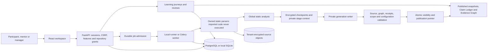

# Generation publication and project learning

Implementation date: 15 October 2026. Additive schema head: 0025. This document describes implemented behavior and remaining qualification limits. The overall release verdict is **BLOCKED** until the acceptance matrix is satisfied.

## System and container views

The API, worker and source store retain their existing identities and authorization. No extra service or external AI dependency was added. Local qualification uses Python 3.12.14 and the preserved dependency lockfiles. Real Redis delivery remains separately unqualified in this workspace.

## Publication persistence

Migration 0024 adds six tables without adding columns to or rebuilding existing Records: `analysis_generations`, `generation_records`, `generation_receipts`, `generation_chunks`, `generation_audits` and `published_generations`. Existing Record expression indexes, snapshots and document contents are preserved. Generation and ownership foreign keys include organization and repository scope. Audit ownership also references scoped event/activity keys. Migration 0025 adds four learning tables described below.

An analysis generation pins its job, inventory, complete computation signature, content idempotency key, branch and expected publication-pointer revision. The signature is derived from tenant/repository, source bytes/inventory, parser/analyzer version, native profile, base, advisory input and capture options. Stage receipts bind all earlier receipt digests. Each context chunk authenticates its generation, tenant, repository, signature, stage and ordinal. Context uses JSON and explicit record references, never executable object deserialization.

Stages execute sequentially with durable dependencies:

1. Snapshot identity and captured context.
2. Evidence construction.
3. Claim publication and associations.
4. Native findings.
5. Dependencies and cached advisories.
6. Finding correlation and comparison.
7. Finding history.
8. Artifact graph.
9. Configuration and resource graph.
10. Function graph.
11. Ownership and shared-evidence graph.
12. Policy evaluation/projection.
13. Change impact.
14. Final snapshot, Engineering Changes, audit and read projection.

These are resumable stage boundaries inside the existing durable job lifecycle. They are not separately broker-dispatched tasks. A crash inside a stage replays that stage with deterministic record identities; a completed stage restores authenticated context. A repeated graph identity/relationship reuses its existing row. Finding occurrence and audit identities are stable across replay. Existing historical snapshots are never rewritten by staging.

Private Record inserts/updates commit in bounded work batches. The current Record batch limit is 250; encrypted context chunks contain at most 256,000 ASCII JSON characters, and a stage context is capped at 64 MB. File preparation receipts retain their 4 MB cap. The completed global checkpoint retains its configured 64 MB default cap; durable inventory jobs fail explicitly if that checkpoint cannot be saved. They do not silently continue without recovery state. These are persistence bounds, not a claim that all global-analysis collections are memory bounded.

Every accepted batch checks the job lease/fencing token and current actor, feature and repository permissions. Scoped database constraints protect the Core ownership inserts and private finding updates. A stage cannot commit after cancellation or token replacement wins. ORM finding working state is limited to 250 cached objects; JSON correlation state still includes repository-level observations. Inverted evidence/resource indexes replace repeated full scans. Public queries retain publication predicates.

## Visibility, validation and promotion

Records without generation ownership remain legacy published data. Ordinary ORM reads exclude ownership belonging to a non-PUBLISHED generation. This applies to direct IDs, aliases, counts, nested selects, snapshot views/inventory, quality/cloud projections, finding history/concepts, and public audit/activity. The PostgreSQL claim full-text query has the corresponding explicit SQL predicate. Worker access to private rows is confined to its Session context. Cleanup detaches live private objects, including cached objects whose ORM refresh could otherwise bypass loader criteria.

Validation checks required receipts/dependency digests/chunks/counts, the unique job snapshot, tenant and snapshot scopes, graph/evidence references, claim evidence association and source-object integrity against the captured inventory. Validation reads Records in bounded stage/ordinal pages. Analyzer/parser identity and the current native-profile version lineage are rechecked before promotion.

The promotion transaction rechecks authorization/fencing, locks the generation and repository, verifies the expected branch-pointer revision, changes visibility to PUBLISHED, advances the pointer, records the terminal job and removes obsolete computation/preparation checkpoints. Existing snapshots remain visible until this commit. A superseded generation cannot overwrite a newer pointer. A lost commit acknowledgement is resolved from the committed generation/job state; it cannot fabricate a FAILED job for a consistent published result.

Expiry maintenance removes at most 250 private context chunks per call and never removes active-worker context. It preserves receipts, Records, historical graphs and learning evidence. Expired unfinished generations become ABANDONED and remain private. Input maintenance also has a bounded 1,000-row expiry page. Published generations retain their historical visibility after private recovery context expires.

## Learning model and workflows

Migration 0025 adds `learning_journeys`, `learning_objectives`, `learning_assessments` and `learning_reviews`. A journey pins a published target snapshot, participant, mentor, accountable manager, optional team, role and retention window. Internal transfers additionally require a distinct authorized prior repository. Database relationships qualify memberships, repositories, journeys, objectives and evidence Records by tenant. Participant, mentor and manager must be three distinct active members.

The `/learning` workspace module provides a bounded project knowledge dashboard, role-filtered objectives, skill declarations, gap labels, project comparison, assessments, feedback, progress, manager completion and refresh. Knowledge is read from actual published claims, graph nodes and findings. Status, confidence, source path and static-analysis limits are displayed. No observed technology or self-declared skill automatically demonstrates competence. Initial skill reports identify their declarant; the participant can attest updated declarations. Objectives still require assessment.

A manager with `learning.manage` creates the assignment and must be its accountable manager. Delegated team managers require their administered team. All three people need target access and, for transfer learning, prior-project access. Team members/reviewers must remain in scope. Ordinary administrators and platform operators do not gain private response/source access solely from their role. The existing administration feature catalog controls the `onboarding` entitlement at platform, organization, team, role and user scopes.

Only the participant submits answers. Citations must refer to the objective's captured knowledge/evidence in the same snapshot. A mentor explicitly supplies a 0–4 score and feedback; scores below 3 request changes. Submission alone never approves an objective. Only the manager completes a current revision, after every objective is approved and the source snapshot is still current. Optimistic versions prevent stale/duplicate submissions. Assessment attempts are capped at five per objective; a path contains at most 16 objectives per revision and 32 revisions. Directory search and all list/knowledge queries are bounded and disclose their scope.

New target publication produces a refresh requirement on read/completion. Manager-approved refresh creates a new objective revision; earlier assessments, approvals and completion records remain. Internal-transfer comparison retains the explicitly pinned prior-project baseline. It compares observed technology labels within the bounded knowledge preview and does not infer employee competence.

Answers and review notes are encrypted with the existing operator-managed encryption key system. Audits record operations/IDs/outcomes rather than response text. Retention is selectable from 7 to 180 days at assignment (90-day default). Expired response text is withheld and further mutations are denied. This is application retention enforcement, not physical erasure or a compliance certification. Learning query caches include active organization, user and access revision; a scope change discards visible prior learning state and ignores obsolete mutation responses.

## API contract

All routes below use the existing session, CSRF, feature and tenant controls. The packaged learning OpenAPI contract is generated from `app.openapi()`. Non-production installations expose `/api/openapi.json` and `/api/docs`; production disables those HTTP documentation routes.

| Route | Behavior |
|---|---|
| GET `/api/learning/knowledge/{repository_id}` | Published knowledge preview; at most 100 Records per kind |
| GET `/api/learning/members` | Manager-scoped bounded directory with search/offset/limit and optional team |
| GET/POST `/api/learning/journeys` | Assigned paths / idempotent manager assignment |
| GET `/api/learning/journeys/{id}` | Authorized private detail, progress, feedback and refresh state |
| POST `/api/learning/journeys/{id}/skills` | Versioned participant skill attestation |
| POST `/api/learning/journeys/{id}/objectives/{objective}/submit` | Versioned participant answer and captured citations |
| POST `/api/learning/journeys/{id}/objectives/{objective}/review` | Versioned mentor assessment |
| POST `/api/learning/journeys/{id}/complete` | Manager completion of an approved current revision |
| POST `/api/learning/journeys/{id}/refresh` | Manager-approved new source revision, retaining earlier history |

Authorization failures disclose no private path existence. Stale versions and invalid transition states return 409; invalid citations/modes return 422. Source/evidence retrieval continues through the existing authorized record inspector.

## Operational upgrade and recovery

Back up the database, source objects and operator keys together before migration. Apply `python -m alembic upgrade head` to an operator-owned installation; do not use `create_all` for upgrades. Populated generation/learning downgrades refuse to discard data and require an operator-reviewed migration. The qualification scripts use only newly created or previously generated QA instances; they never migrate an unknown customer database.

API, worker and maintenance must use the same database, blob store and key ring. Start the existing local runner or production Celery workers using the documented launcher. Preserve encrypted retained inputs when recovering a worker. Retry through the existing bounded job control; do not delete an unfinished generation or reset retry counts. Inspect generation state, receipt stages, job error codes, pointer revision and current grants. A database outage can interrupt the attempt; a fresh Session restores completed receipts after service recovery.

Metrics include staging batches, inserted Records, maximum Record batch size, checkpoint hits, receipt reuse and existing per-component/stage timing. No credential/source content is added to logs. Current-epoch performance is separate from prior-attempt work; overlapping component times must not be summed as wall time. Parent cProfile and sampled process-tree memory have explicit scope/limitations in the saved performance report.

## Remaining release gates

The global analyzer still aggregates repository-level observations and snapshot JSON in memory. Bounded persistence and a bounded ORM cache do not establish a fully streaming global verifier or maximum-scale memory guarantee. A newly retrieved OpenMetadata commit archive has a different ZIP hash from the historical input: its cold run captures 21,636 files and retains 7,744 parser artifacts, then fails at VERIFYING with MemoryError under an explicit 768 MB process-tree ceiling. Database integrity passes and no generation/pointer is published. The exact historical ZIP remains unqualified. Real Redis/Celery broker interruption/redelivery/lost acknowledgement remain NOT_TESTED here; worker subprocess and PostgreSQL connection-loss tests are distinct evidence. Parser CPU/helper limits exist, but complete filesystem/network sandboxing is not demonstrated on this Windows environment. Production RLS/TLS/provider/object-storage/load/complete key-and-object disaster recovery remain separate gates. Local schema-0025 database/object/key restore and fresh API learning reads pass, without establishing production RPO/RTO. No production readiness or formal compliance is asserted.
