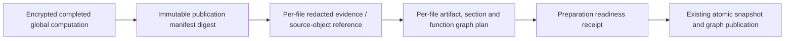

# Publication preparation, browser acceptance and database tenant integrity

Date: 15 October 2026 (Asia/Kolkata). This continuation preserves migrations 0021 and the prior lease fixes. **Overall release remains BLOCKED.** Work described here is implemented; the complete remaining assignment is not finished.

## Implemented publication work

Migration 0022 adds private `publication_units` with tenant/repository-qualified job relationships. Completed units contain authenticated encrypted envelopes, signatures, digests, schema version and dependency keys. They are separate from public Records and cannot appear as completed findings, claims, evidence or snapshots through ordinary record queries.

The current unit schema is `projecttrace-publication-unit-v3`. Its graph preparation chain is:

Each file's evidence and graph preparation commits independently after checking the current worker lease. A replaced token or cancellation rejects the next unit write. Source/object reads occur after ending the short lease-renewal transaction. Unit size is capped at 4 MB; the manifest retains a path digest/count rather than copying an arbitrarily large path list. Graph plans store explicit typed nodes and edges with symbolic references to their snapshot/component/evidence. Graph validation rejects invalid local identities, node scope and relationships. Publication resolves these plans into the actual snapshot namespace. No imported code executes.

A real child process claims a queued job, commits preparation units and exits immediately using `os._exit`. The parent observes no published snapshot/evidence/graph, expires and recovers the worker lease, acquires a different fencing token and resumes. Completed receipt ciphertext is unchanged; the remaining units complete, and a repeated preparation saves no additional units. This test runs against SQLite; separate PostgreSQL tests cover receipt FK scope and stale-worker fencing. It is not a Redis/Celery acknowledgement test.

Receipts expire within the retained input lifetime or 72 hours. Successful publication removes them in the final transaction. Bounded expiry maintenance removes expired private receipts. Existing global-computation checkpoint behavior remains intact.

### Limits still requiring implementation

The private units cover file evidence and artifact/section/function graph preparation. They do NOT yet checkpoint global claim correlation, configuration/resource graph construction, finding-history updates, policy evaluation or impact calculation independently. Final relational insertion remains one atomic output transaction. There is no complete staged-generation promotion/published-pointer implementation. Global analyzer result aggregation still retains repository-wide collections, and oversized global checkpoint fallback remains. Consequently these changes must not be represented as completion of the full durable pipeline or OpenMetadata qualification.

## Database tenant integrity

A direct-SQL negative test reproduced a pre-existing gap: Record's separate organization and repository foreign keys allowed a valid organization to reference a different tenant's repository, bypassing ORM guards. The test failed before the fix.

Migration 0023 adds a unique repository/organization key and a composite PostgreSQL Record repository/organization foreign key. SQLite uses database triggers for inserts, scoped updates and repository tenant reassignment; this avoids rebuilding the large Record table or losing expression indexes. Fresh ORM-created test schemas also use the model's composite FK.

Before changing schema, the migration rejects existing mismatched or orphaned Record/repository relationships for operator review. It never repairs, deletes or rewrites questionable records silently. Tests verify populated valid records and all existing Record expression indexes remain unchanged, and invalid legacy records remain intact when upgrade is refused. Both migration-head expectations were legitimately advanced to 0023; preservation assertions were retained.

This closes the reproduced Record/repository relationship gap. It is not a claim of complete production RLS, isolation of every typed table or parser filesystem/network sandboxing.

## Windows storage root cause and fix

Preparing the new private QA instance exposed Windows path-length failure in encrypted blob replacement. Operator-owned local storage paths now use canonical Windows extended-length paths. The regression writes/decrypts an encrypted source blob beyond 260 path characters and confirms plaintext does not appear on disk. Untrusted repository path validation is unchanged.

## Six previously untested browser cases

The historical mirror assumptions were replaced with a generated manifest from pinned, actually analyzed source archives. Assertions still require two authorized partial repositories, exact fixture file/evidence/diagnostic counts, bounded readiness time, correct snapshot pinning, paginated scope, recoverable errors and no mutation/reanalysis during a read retry.

The isolated generator is `python -m scripts.prepare_browser_qa`. It requires a NEW directory and explicit ZIP paths/SHA-256 digests, checks the digests before opening the QA instance, uses a newly migrated SQLite database, analyzes source through the real API and stores credentials only in private `.secret` files. It creates 1,000 labelled synthetic volume users/activity events for administration testing; it does not invent source findings or claims. Repository tests use a separate viewer granted only the two inputs, preventing the administration import test from changing their repository count.

All six cases passed twice, including a rerun on a newly generated QA instance:

1. Administration bounded loading, pagination, sanitized activity export, accessibility/mobile.
2. Invitation acceptance, team delegation, feature denial, session revocation and reactivation.
3. Real fixture import with claims/evidence and scoped administrative job metadata.
4. Rate-limited identity read preserves session and offers retry.
5. Two repositories load independently, disclose partial scope and pin Explore's snapshot.
6. Repository read failure recovers without triggering analysis retries or inventing zeros.

Pinned inputs:

| Input | Identity | Actual scope in generated fixture |
|---|---|---|
| Spring PetClinic | commit 500158f732419217507c7656904b8e6aa1bcc0d6; archive SHA-256 160c4b3eec1cdda42e6821a8e1a3e8d9b446c52423bd1d8ef14d19a8ee5e770f | 121 retained text files; 50/91 source files parsed; 70 evidence records; PARTIAL |
| Preserved ProjectTrace source | archive SHA-256 5f97366e7819659977ac7d588a1a5f733ab33cad8141b876cc95220d3d471ae3 | 461 retained text files; 259/276 source files parsed; 440 evidence records; PARTIAL |

These retained-text counts differ from captured inventory counts (132 and 465). They do not imply complete semantic/security coverage. The source archives were not edited to obtain acceptance.

## Real PostgreSQL qualification

A portable PostgreSQL 17.11 distribution was obtained from the EDB binary-archive flow linked by PostgreSQL's official Windows download page. It runs only from the Codex workspace, on 127.0.0.1:55432, with a new password-authenticated disposable cluster. No system service, installer, public listener or paid resource was used. The archive hash is in `postgresql-binary-source.json`; the EXE is unsigned, so no Authenticode or independent vendor checksum claim is made.

Ten selected PostgreSQL tests passed after correcting a stale migration-head assertion; after the Record integrity change, eleven passed. They cover concurrent duplicate claims/fairness, recovery fencing, graph/tenant constraints, populated migration preservation, administration operations and the new private receipt and Record scope constraints. Each test owns a UUID schema and cleans up only that schema. This is local PostgreSQL concurrency qualification, not production TLS/RLS/DR or Redis qualification.

## Verification and root-cause record

- Initial focused publication/queue/checkpoint/migration selection: 19 passed.
- Publication/storage/security selection: 46 passed.
- Final crash/recovery/fencing/storage unit suite: 6 passed.
- Graph draft/integration/history/impact selection: 30 passed.
- Frontend: 41 passed across 10 files; TypeScript and production build passed, 42 routes prerendered.
- Six prior browser cases: 6 passed, 0 skipped (34.3 s); independently regenerated instance: 6 passed, 0 skipped (37.3 s).
- Frozen schema-0022 backend run: 535 passed, 9 opt-in PostgreSQL skips, 394.66 s. PostgreSQL checks were run separately with actual infrastructure; these overlapping counts must not be summed.
- Record/migration preservation selection: 5 passed; real-pipeline/receipt selection after Record FK: 11 passed.

An intermediate full run failed because the agent changed the private draft schema during the run, so parent and child test processes loaded different code. That run is retained but is not final passing evidence. Source was then frozen and the full suite passed. The first six-case browser run found fixture cross-test interference (admin import added a third repository); isolating the repository viewer fixed it while preserving the exact-count assertion. The first PostgreSQL run exposed a stale 0020 expectation, corrected to the actual additive migration head. The direct-SQL scope probe failed before the integrity fix and passes after it.

The final schema-0023 full regression (with real PostgreSQL enabled) and the backed-up QA clean-restart/browser results are appended once completed.

## Operational and preservation notes

Continuation source backup: `work/staged-publication-backup/source.zip` in the Codex workspace. Existing earlier backups, keys, fixtures and data remain. Only disposable QA databases were migrated during this work. Before upgrading the reproduced QA database to 0023, an online SQLite backup was taken and integrity checked; API restart uses the same database and keys. No commit, push, public deployment, live secret rotation or destructive customer-data operation occurred.

For QA reproduction, provide `--directory`, `--petclinic`, `--petclinic-sha256`, `--projecttrace`, and `--projecttrace-sha256` to the generator. Set API environment from its private runtime.json, start the API and UI on loopback, set PROJECTTRACE_ADMIN_QA to the QA directory and PROJECTTRACE_LARGE_ACCOUNT to repository-account.secret, then run the two browser spec files. Keep these .secret files and source objects private.

## Remaining assignment

Full bounded generation publication and global-memory work remain incomplete. Redis/Celery loss/acknowledgement recovery, unchanged OpenMetadata scale runs and live external-provider scenarios remain unqualified. Developer Onboarding & Knowledge Transfer remains missing in both modes; no empty feature screens or fabricated demonstrations were added. Production parser network/filesystem isolation, full database tenant-policy coverage and sustained load/DR remain release gates. **Overall verdict remains BLOCKED.**

## Clean restart and local backup/restore evidence

The reproduced QA database was backed up using SQLite's online backup API, passed integrity_check, upgraded to 0023 and reopened by a fresh API process with the same source objects and encryption key. All six browser cases passed afterward (37.8 s, no skips), demonstrating retained repository snapshots, permissions and active workflows after restart.

A real PostgreSQL custom-format pg_dump was restored with pg_restore into a separate newly created qualification database. Every public-table count, the ordered SHA-256 digest of all Records, migration 0023 and the Record tenant FK matched. The controlled input was the actual ProjectTrace demo seed, not customer production data. Dump: 268,176 bytes in 2.0119 s. Restore: 1.7933 s. Source and restored databases are retained in the private qualification cluster; no database was deleted. Details are in `postgresql-backup-restore.json`. This tests local dump/restore mechanics, not production encryption-key/object-storage restoration, RPO/RTO, TLS or disaster recovery.

Portable PostgreSQL provenance: [PostgreSQL's Windows download page](https://www.postgresql.org/download/windows/) links the [EDB binary archive page](https://www.enterprisedb.com/download-postgresql-binaries). The downloaded archive hash was measured locally, not independently certified by a vendor checksum.

## Current capability matrix

| Capability | Current status |
|---|---|
| Encrypted global-computation checkpoint | Preserved, regression tested |
| Per-file evidence and typed graph preparation receipts | Implemented; process termination/recovery and fencing tested |
| Complete independent global stages and short atomic generation promotion | PARTIAL / remaining implementation |
| Record/repository database tenant relationship | Implemented for PostgreSQL and SQLite; negative/preservation tests |
| Six previously untested browser workflows | Passed on reproducibly generated inputs |
| Local PostgreSQL concurrency and migrations | Passed selected real-server checks; integrated suite result below |
| Local PostgreSQL dump/restore | Passed controlled demo fixture check |
| Redis/Celery acknowledgement/loss recovery | NOT_TESTED with real Redis |
| Unchanged OpenMetadata large-source qualification | NOT_TESTED for the new design |
| New-hire onboarding and internal transfer | MISSING |
| Full production identity/storage/sandbox/load/DR qualification | Incomplete |

## Final integrated result for this continuation

On 15 October 2026, the complete backend suite with the real local PostgreSQL connection enabled finished: **549 passed, 0 failed, 0 skipped, 1 TestClient deprecation warning in 384.04 s**. Command: `python -m pytest -q --tb=short --junitxml=<outputs>/integrated-postgresql-full-tests.xml` with PROJECTTRACE_TEST_POSTGRES_URL pointing to the private loopback qualification cluster. The warning was retained, not suppressed. No test assertion was weakened. Frontend: 41 passed; TypeScript and production build passed. Final browser restart/upgrade acceptance: 6 passed, 0 skipped.

The tests and benchmarks in this report overlap; counts are not summed as unique acceptance checks. The complete suite now executes the previously optional PostgreSQL scenarios against real PostgreSQL. Redis/Celery broker acknowledgement recovery remains untested with real Redis. The process-termination test is a real owned Python worker/lease test, not a Redis test.

Temporary API/UI/PostgreSQL processes were stopped after verification. Their data, source objects, keys and backups remain in the workspace. No Windows service was installed. The qualification cluster can be restarted explicitly from its preserved data directory; no customer database was deleted.

Source changes in this continuation: backend/db.py, backend/domain.py, backend/jobs.py, backend/queue.py, backend/repository_store.py; new backend/publication_units.py, backend/storage_paths.py, migrations/0022_publication_units.py, migrations/0023_record_tenant_integrity.py; new tests/test_publication_units.py, tests/test_record_scope_integrity.py; tests/test_migrations.py and tests/test_postgresql_integration.py; new scripts/prepare_browser_qa.py; frontend/e2e/repository-reliability.spec.ts; and the saved implementation documentation. Prior lease fixes and global-computation checkpoints remain intact.

**The overall assignment remains incomplete and BLOCKED.** The latest gates closed here are real local PostgreSQL qualification, the six browser cases and the reproduced direct-SQL Record/repository tenant gap. Complete resumable global generation publication, bounded global memory, both onboarding modes and remaining production acceptance still require engineering work. This report does not declare any of those capabilities completed.
